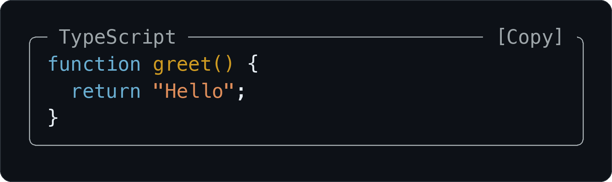

# pi-codeblocks

[Pi](https://pi.dev) 코딩 에이전트 TUI의 Markdown 코드 블록에 테두리, 형식 이름, 문법 강조와 복사 버튼을 더합니다.

[English](README.md) · **한국어** · [日本語](README-ja.md) · [简体中文](README-zh-CN.md) · [Français](README-fr.md) · [Español](README-es.md) · [Português (Brasil)](README-pt-BR.md)



Node.js 22.19.0 이상과 Pi 0.79.9 이상이 필요합니다. 복사와 Markdown 보정은 Pi 0.85.1부터 검증했습니다. Pi 0.79.9와 0.80.3에서는 테두리만 표시합니다.

## 설치

```bash
pi install /path/to/pi-codeblocks  # 로컬 체크아웃
pi install npm:pi-codeblocks       # npm 공개 후
```

Pi를 다시 시작하거나 `/reload`를 실행하세요. 설치 없이 써보려면 `pi -e /path/to/pi-codeblocks/extensions/code-blocks.ts`를 실행하세요. 제거하려면 `pi remove`에 설치할 때와 같은 소스를 넘기면 됩니다.

## 코드 복사

- **마우스:** 전체화면에서 생성이 끝난 비어 있지 않은 코드 블록에 24열 이상이 주어지면 `[Copy]` 버튼이 표시됩니다. 복사에 성공하면 누른 버튼만 1.5초 동안 `[Copied!]`로 바뀝니다. 드래그는 화면의 텍스트를 선택합니다.
- **키보드:** `/codeblocks copy`는 현재 분기의 최신 어시스턴트 응답에서 비어 있지 않은 첫 번째 코드 블록을 복사합니다. 인용문과 목록 안의 코드도 포함합니다. 번호는 응답의 위에서부터 매기므로 `/codeblocks copy 2`는 두 번째 블록을 복사합니다. 번호가 잘못됐거나 범위를 벗어났거나 응답에 코드가 없으면 클립보드를 바꾸지 않습니다. 일반·전체화면 TUI에서만 동작하며 RPC, JSON, 출력 모드에서는 동작하지 않습니다.
- **복사 내용:** 줄바꿈과 들여쓰기는 유지합니다. 탭은 Pi가 표시하는 세 칸 공백으로 바뀌고, 펜스, 테두리 여백, 터미널 제어 문자는 제외합니다. 두 복사 방식 모두 Pi의 코드 판정과 클립보드 기능을 사용하며 요청 순서대로 씁니다.

## Markdown 보정

생성이 끝난 어시스턴트 응답에서 한 줄 펜스와 인식 가능한 셸 명령어 박스를 화면 표시용 코드 블록으로 보정합니다. 내부 백틱과 `python -m pytest`, `go test ./...` 같은 명령어의 실행 파일 이름은 유지합니다. 별도 줄에 표시되는 수식이 있는 응답, 여러 줄 인라인 코드 안의 박스, 백슬래시 뒤 공백의 의미가 모호한 박스는 그대로 둡니다. 코드를 실행하거나 저장된 메시지를 바꾸지 않습니다.

## 옵션

Pi를 시작하기 전에 환경 변수를 설정하세요. 값을 지정하지 않거나 비워 두면 기본값을 씁니다. 대소문자와 관계없이 `0`, `false`, `no`, `off`는 끄고, 그 밖의 비어 있지 않은 값은 켭니다.

| 변수 | 기본값 | 켰을 때 |
|---|---|---|
| `PI_CODEBLOCKS_LANG` | 켜짐 | JavaScript, TypeScript, Text 같은 형식 이름 표시 |
| `PI_CODEBLOCKS_COPY` | 켜짐 | 마우스 복사 버튼 켜기. 키보드 복사는 별개 |
| `PI_CODEBLOCKS_FILL` | 꺼짐 | Pi 테마의 중립 도구 배경색으로 채우기 |
| `PI_CODEBLOCKS_ASCII` | 꺼짐 | 테두리는 `+`, `-`, `\|`, 줄임 표시는 `...` 사용 |
| `PI_CODEBLOCKS_BAR` | 꺼짐 | 상단선만 남겨 코드에 전체 폭 사용 |

## 호환성

Pi의 문법 강조와 테마 색을 사용하며 긴 줄은 블록 폭 안에서 줄바꿈합니다. Mermaid와 12열 미만 블록은 Pi 기본 표시를 유지합니다. 프레임은 Pi의 비공개 `Markdown.prototype.renderToken`을 사용하며, 이 메서드가 없으면 Pi 기본 표시로 돌아갑니다. 코드 블록 렌더러 확장은 한 번에 하나만 사용하세요.

로컬에서는 macOS ARM64에서 Node.js 26과 Pi 0.79.9, 0.80.3, 0.85.1, 1.3.0, 1.4.0, 1.5.0–1.5.2를 테스트했습니다. [호환성 워크플로](https://github.com/stellarsailor/pi-codeblocks/actions/workflows/compatibility.yml)는 macOS, Linux, Windows를 대상으로 하며, 실제 마우스 클릭과 데스크톱 클립보드는 검증하지 않습니다.

## 개발

```bash
npm install       # TypeScript와 Node 타입 설치
npm test          # 로컬 또는 전역 Pi 설치 사용
npm run typecheck # Pi 타입을 위해 로컬 Pi 설치 필요
```

MIT · [변경 이력](CHANGELOG.md)
